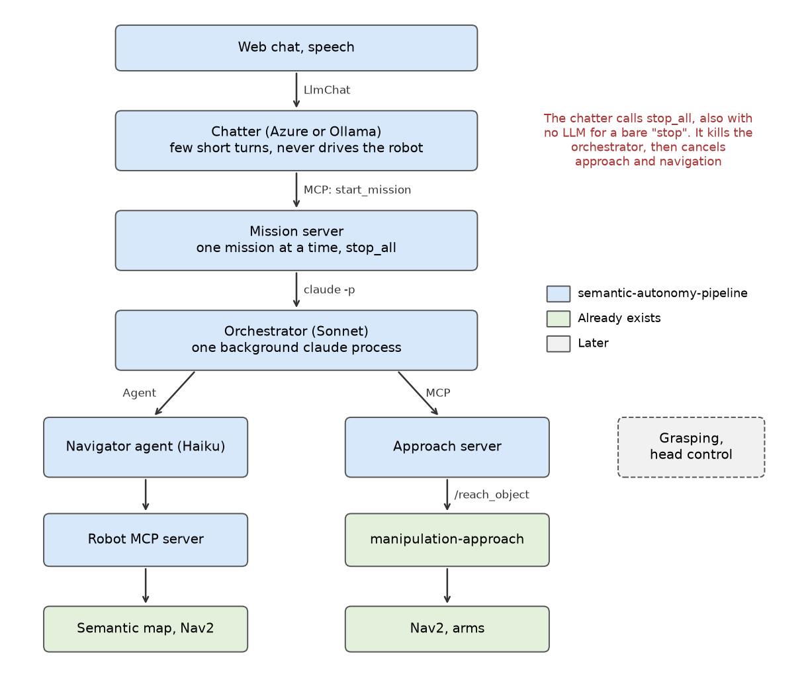

# semantic-autonomy-pipeline

All the agent code of the robot: the voice of the robot, the orchestrator that decides what to do, the navigator
agent, the MCP servers they use, and the chat front ends. Grasping and head control are not part of it yet.

The robot skills stay in their own repositories: mapping and Nav2 in `visual-language-navigation`, the last
stretch to an object in `manipulation-approach`.



See [docs/architecture.md](docs/architecture.md) for how a request flows and why it is built this way, and
[docs/robot_server.md](docs/robot_server.md) for the robot tools.

| Part | What it is | Default |
|---|---|---|
| `chatter.py`, `llmchat_input_mode.py` | MCP host of `yarp-mcpHosts` serving `LlmChat`. A bare stop command skips the LLM. | Azure |
| `mission_server.py` | MCP server that runs one orchestrator at a time. | port 8767, Sonnet |
| `robot_server.py` | MCP server over the semantic map and Nav2. | port 8765 |
| `approach_server.py` | MCP server around `/reach_object`. | port 8766 |
| `web_chat/`, `speech_pipeline/` | Web page and voice bridge to the chatter. | |
| `agents/` | Prompts of the chatter, the orchestrator and the navigator. | |

## Requirements

- `visual-language-navigation`, which provides `ros2_vlmaps_interfaces`, the semantic map server and Nav2
- `manipulation-approach` in the same colcon workspace, with its pipeline running
- `yarp-mcpServers` and `yarp-mcpHosts` installed, and `yarpserver`
- The `claude` CLI, logged in, for the orchestrator and the navigator

## Build

```bash
cd ~/ws_ros2 && colcon build --packages-select semantic_autonomy speech_pipeline
cd ~/visual-language-navigation && colcon build --packages-select visual_language_navigation
```

**Both builds are needed.** An older install of `visual_language_navigation` still registers the robot server and
wins over this one, so `robot` fails with `No module named 'visual_language_navigation.llm'`. Without the first
build the launchers print `No installed package provides server type` and then wait forever. To check:

```bash
python3 -m yarp_mcpServer_core.launcher --list_servers | grep -E 'Robot|Approach|Mission'   # all "ok"
```

## Run

The chatter defaults to Azure. `AZURE_API_MODE` selects `responses` (default) or `chat_completions`, which also
needs `AZURE_API_VERSION`.

```bash
export AZURE_API_KEY=... AZURE_ENDPOINT=... DEPLOYMENT_ID=...
~/ws_ros2/src/semantic-autonomy-pipeline/scripts/run_all.sh
```

For an Ollama server on the network, with a model that supports tools:

```bash
scripts/run_all.sh --ros-args -p backend:=ollama -p backend_url:=http://<host>:11434/v1 -p backend_model:=<model>
```

`run_all.sh` starts the three MCP servers and the chatter. `Ctrl+C` stops everything and cancels the goals. For the
web page run `ros2 run semantic_autonomy chat_backend`, and for voice `ros2 run speech_pipeline speech_bridge`.

## Tests

Source the workspaces first, then run from `semantic_autonomy/test`.

```bash
python3 test_stack.py                           # Scripted LLMs and robot: no usage, about one minute
python3 live_dry_run.py                         # Real orchestrator and navigator over a scripted robot: spends Claude usage
python3 live_dry_run.py azure                   # The same with a real chatter
python3 live_dry_run.py ollama <url> <model>
```

## Known gaps

- **No real chatter model has been tested.** Azure and Ollama ran through their real backend classes, against a
  scripted server. How well a given model calls `start_mission` is unknown, and it matters: a model that says "on
  it" without calling the tool leaves the person waiting for nothing. Test a local model with `live_dry_run.py`.
- **Not run on the robot.** Real Nav2, the semantic map, DINO/SAM, the arms and real audio have not been part of
  any run of this pipeline. The robot server moved with its tool schemas unchanged, but nothing has driven it here.
- **The orchestrator can see the robot tools.** Claude Code offers no way to give an MCP server to a sub-agent alone
  (see [the architecture notes](docs/architecture.md#what-the-agents-can-do)). Only its prompt keeps it on the navigator.
- **Hands stay raised.** Nothing lowers them after an approach or a cancel, so the next navigation walks with raised
  arms. Lowering them belongs in `manipulation-approach`.
- **No head control.** `/reach_object` needs the object in view at the start. With a fixed head, the 0.8 m standoff
  of the navigator may not show it. The orchestrator checks with the camera and reports it.
- **The chatter connects once.** If the mission server restarts, restart the chatter. Its tools fail until then,
  but stop words keep working, because they open their own connection.
- **Conversation history is not trimmed.** It grows until `new conversation`. This matters most on a small local
  model during a long session.
- **`LlmChat.srv` is still in `ros2_vlmaps_interfaces`.** Nothing in `visual-language-navigation` uses it now.
- **A stop in words depends on the LLM.** Only a bare command ("stop", "ferma", "please stop") skips it. Anything
  else, like "forget it", needs the model to recognise the intent, so it takes a turn and fails if the LLM is down.
- **Usage limits.** Each mission spends Claude usage on an orchestrator and a sub-agent.
- **This is not a safety stop.** `stop_all` needs Python, ROS and MCP to be up. The emergency stop of the robot
  remains the safety system.
